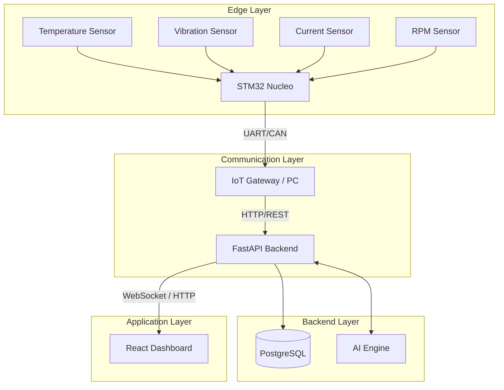
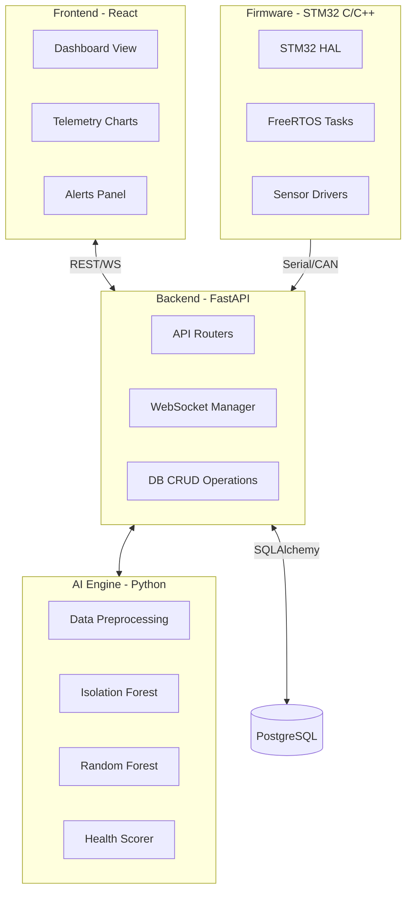
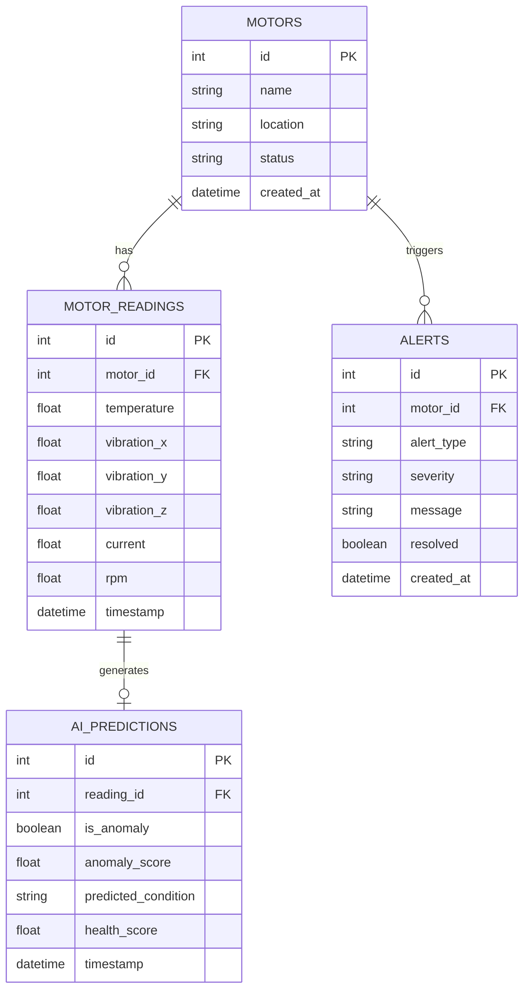
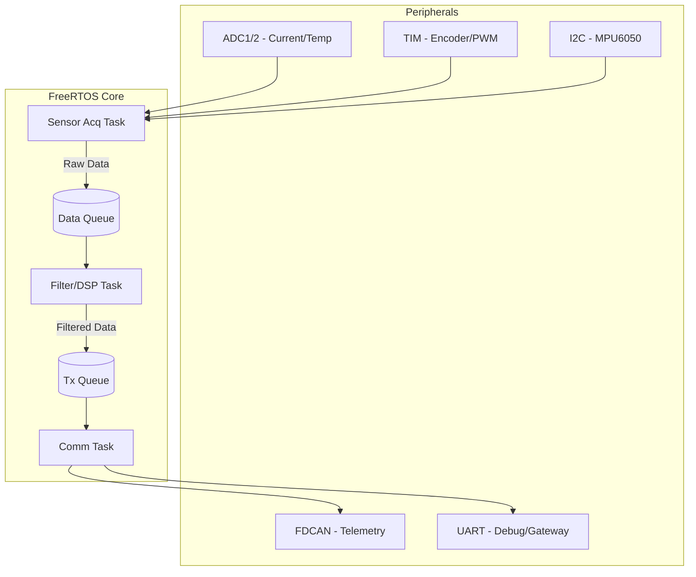

# AI-MotorGuard: AI-Driven Smart Industrial Motor Health Monitoring and Predictive Maintenance System


## Abstract
AI-MotorGuard is an advanced, end-to-end industrial IoT solution designed for continuous motor health monitoring and predictive maintenance. Integrating an STM32 edge controller for real-time sensor data acquisition, robust IoT telemetry protocols, and a sophisticated AI backend, the system detects anomalies before catastrophic failures occur. The AI engine leverages an Isolation Forest for unsupervised anomaly detection and a Random Forest classifier for precise fault categorization (e.g., bearing failure, stator winding short). All telemetry and AI insights are visualized on a real-time, interactive React dashboard, bridging the gap between raw hardware signals and actionable industrial intelligence.

## Problem Statement
Industrial electric motors account for roughly 70% of total industrial electricity consumption. Unplanned failures lead to significant production downtime, with costs reaching 5 to 20 times more than planned maintenance. Traditional monitoring relies on periodic, manual inspections and reactive maintenance strategies. There is a critical need for continuous, intelligent, and automated monitoring systems that can predict failures and schedule maintenance proactively.

## Industrial Impact & ROI
**The economic imperative for AI-MotorGuard is clear:**
- **Downtime Reduction:** By shifting from reactive to predictive maintenance, industrial plants can reduce unplanned downtime by an estimated **25-40%**.
- **Cost Savings:** In a typical medium-scale manufacturing plant, preventing a single major motor failure can save between **$5,000 to $50,000** in immediate repair costs and lost production revenue.
- **Asset Lifespan:** Continuous health monitoring extends the operational life of motors by ensuring they operate within optimal thermal and vibration parameters, reducing capital expenditure (CAPEX) on replacement hardware.

## Objectives
1. **Continuous Monitoring:** Implement 24/7 telemetry of motor parameters (temperature, vibration, current, RPM).
2. **Edge Computing:** Utilize STM32 microcontrollers for high-speed, reliable sensor data acquisition.
3. **AI Anomaly Detection:** Detect abnormal operational patterns using unsupervised machine learning.
4. **Predictive Maintenance:** Classify specific motor faults and predict potential failure modes.
5. **Health Scoring:** Provide a dynamic, easy-to-understand motor health score (0-100%).
6. **IoT Telemetry:** Establish reliable, low-latency communication between the edge node and the backend.
7. **Real-time Dashboard:** Develop an intuitive UI for monitoring live data, historical trends, and AI predictions.
8. **Hardware-Software Integration:** Seamlessly bridge embedded C/C++ firmware with modern web technologies.
9. **Dual-Mode Operation:** Support both hardware-in-the-loop and software simulation modes for development and testing.

## Existing System Limitations
- Reliance on manual, periodic inspections.
- Reactive maintenance leading to costly unexpected downtime.
- Lack of AI-driven predictive insights.
- No real-time, centralized monitoring across multiple assets.
- Inability to correlate multidimensional sensor data efficiently.

## Proposed System Advantages
- **Automated Monitoring:** Eliminates manual data collection.
- **Edge-AI Pipeline:** Fast anomaly detection and intelligent insights.
- **Predictive Maintenance:** Reduces downtime by scheduling repairs before catastrophic failures.
- **Real-Time IoT Dashboard:** Accessible, centralized monitoring.
- **Dual Mode:** Includes a robust simulation mode (Digital Twin) for validation without physical hardware.

## System Architecture



## Hardware Architecture
For detailed component lists and procurement specifications, see [HARDWARE_SPEC.md](HARDWARE_SPEC.md).
- **Microcontroller:** STM32 Nucleo-H743ZI (or similar)
- **Current Sensor:** ACS712 (Hall-effect)
- **Temperature Sensor:** LM35 or DS18B20
- **Vibration Sensor:** MPU6050 or ADXL345 (Accelerometers)
- **Speed/RPM Sensor:** Hall-effect sensor or optical encoder
- **Communication Module:** CAN transceiver (MCP2515/SN65HVD230)
- **Motor Driver:** L298N or BTS7960
- **Actuator:** DC or BLDC Motor

## Software Architecture



## AI Methodology
- **Isolation Forest:** Used for unsupervised anomaly detection. It isolates anomalies instead of profiling normal data points, making it highly effective for multidimensional sensor data.
- **Random Forest Classifier:** A supervised ensemble learning method used to classify specific fault conditions based on feature-engineered sensor readings.
- **Feature Engineering:** Creation of rolling averages, variance, and peak-to-peak metrics from raw sensor data to enhance model accuracy.
- **Health Score Computation:** An algorithm that combines the anomaly score and classification probabilities to output a 0-100% health score.

## Dataset
- **Type:** Synthetic dataset generated using physical modeling principles (Digital Twin approach).
- **Size:** 10,000+ samples.
- **Conditions:** 7 distinct motor conditions (Normal, Bearing Imbalance, Stator Short, Overheating, Rotor Unbalance, Misalignment, Under-voltage).
- **Features:** Correlated realistic patterns incorporating baseline physics and added gaussian noise.

## Machine Learning Algorithms
1. **Isolation Forest:** Chosen for its efficiency in high-dimensional spaces and its ability to detect novel, unseen anomalies without requiring labeled anomaly data.
2. **Random Forest:** Selected for its robustness, resistance to overfitting, and ability to handle non-linear relationships in complex sensor data for accurate fault classification.

## Database Schema



## API Documentation

| Method | Path | Description |
|--------|------|-------------|
| GET | `/api/v1/motors` | List all monitored motors |
| POST | `/api/v1/motors` | Register a new motor |
| GET | `/api/v1/motors/{id}` | Get specific motor details |
| GET | `/api/v1/telemetry/{motor_id}` | Get historical telemetry data |
| POST | `/api/v1/telemetry/ingest` | Ingest new sensor readings |
| GET | `/api/v1/ai/predictions/{motor_id}` | Get historical AI predictions |
| GET | `/api/v1/alerts` | List active alerts |
| PUT | `/api/v1/alerts/{id}/resolve` | Mark an alert as resolved |
| GET | `/api/v1/health` | System health check |
| WS | `/ws/telemetry/{motor_id}` | Real-time sensor data stream |
| WS | `/ws/predictions/{motor_id}` | Real-time AI prediction stream |
| WS | `/ws/alerts` | Real-time alert notifications |
| POST | `/api/v1/simulation/start` | Start simulation mode |
| POST | `/api/v1/simulation/stop` | Stop simulation mode |
| POST | `/api/v1/simulation/scenario` | Set simulation failure scenario |

## STM32 Architecture



## CAN Protocol Summary

| Message ID (Hex) | Purpose | Data Payload (8 Bytes) |
|------------------|---------|------------------------|
| 0x100 | Heartbeat | Status flags, Error codes |
| 0x101 | Temperature | Float32 (4B) + Pad |
| 0x102 | Vibration X,Y | Int16 (2B) + Int16 (2B) |
| 0x103 | Vibration Z | Int16 (2B) + Pad |
| 0x104 | Current | Float32 (4B) + Pad |
| 0x105 | RPM | UInt32 (4B) + Pad |

## Installation

### Prerequisites
- Python 3.10+
- Node.js 18+
- PostgreSQL 15+ (or Docker)

### Step-by-Step
1. **Clone repository:**
   ```bash
   git clone <repository_url>
   cd AI-MotorGuard
   ```

2. **Set up PostgreSQL:**
   Using Docker:
   ```bash
   docker run --name motorguard-db -e POSTGRES_USER=admin -e POSTGRES_PASSWORD=admin -e POSTGRES_DB=motorguard -p 5432:5432 -d postgres:15
   ```

3. **Backend Setup:**
   ```bash
   cd backend
   python -m venv venv
   source venv/bin/activate  # On Windows: venv\Scripts\activate
   pip install -r requirements.txt
   ```

4. **Generate Dataset and Train Models:**
   ```bash
   python scripts/generate_data.py
   python scripts/train_models.py
   ```

5. **Start Backend:**
   ```bash
   uvicorn main:app --reload --port 8000
   ```

6. **Frontend Setup:**
   ```bash
   cd ../frontend
   npm install
   ```

7. **Start Frontend:**
   ```bash
   npm start
   ```

## Running the Project
Ensure the database is running, then start the backend (`uvicorn`) and frontend (`npm start`) in separate terminal windows.

## Simulation Mode
For environments without hardware, the backend includes a simulation engine.
1. Navigate to the frontend dashboard.
2. Toggle "Simulation Mode" to ON.
3. Use the control panel to inject anomalies (e.g., "Simulate Bearing Failure").
4. Observe the AI models reacting in real-time on the dashboard charts and alerts panel.

## Hardware Integration
1. Flash the STM32 firmware provided in the `firmware/` directory using STM32CubeIDE.
2. Connect sensors according to the schematics in `docs/hardware/`.
3. Connect the STM32 UART/CAN to the PC/Gateway.
4. Run the Python hardware gateway script:
   ```bash
   cd backend/edge
   python serial_gateway.py --port COM3 --baud 115200
   ```

## Testing
Run backend unit and integration tests:
```bash
cd backend
pytest -v --cov=app tests/
```

## Results
*Placeholder: Expect real-time charts displaying normal sine-wave-like current patterns turning chaotic upon anomaly injection, with the Health Score dropping from 98% to <40% and instant UI alerts.*

## Limitations
- **Synthetic Dataset:** Current AI models are trained on physics-based synthetic data, which may not capture all real-world electrical noise.
- **Simplified Health Score:** The composite health score is an approximation based on probability outputs.
- **Edge AI:** Inference is currently done on the backend server, not directly on the STM32 microcontroller.
- **Single Motor Type:** Models are tuned for a specific induction motor class.
- **No RUL:** Remaining Useful Life (RUL) estimation is not implemented; the system uses risk-based classification.

## Future Scope
- **Edge AI Deployment:** Implement TensorFlow Lite for Microcontrollers (TFLite Micro) directly on the STM32 for localized inference.
- **Multi-Motor Fleet Management:** Scale the dashboard and backend to handle hundreds of synchronous assets.
- **Cloud Integration:** Deploy infrastructure to AWS IoT or Azure IoT Hub.
- **Real-Time RUL:** Integrate LSTM or GRU neural networks for precise Remaining Useful Life predictions.
- **Digital Twin:** Integrate 3D WebGL visualizations representing motor physics in real-time.
- **OPC-UA:** Add support for standard industrial automation protocols.

## Technology Stack

| Component | Technology |
|-----------|------------|
| Edge Hardware | STM32 Nucleo-H743ZI, Custom PCB |
| Firmware | C/C++, STM32 HAL, FreeRTOS |
| Backend API | Python, FastAPI |
| Machine Learning | Scikit-Learn, Pandas, NumPy |
| Database | PostgreSQL, SQLAlchemy, Alembic |
| Frontend | React, Recharts, Tailwind CSS |
| Communication | REST, WebSockets, UART, CAN |

## License
MIT License. See `LICENSE` for more information.
