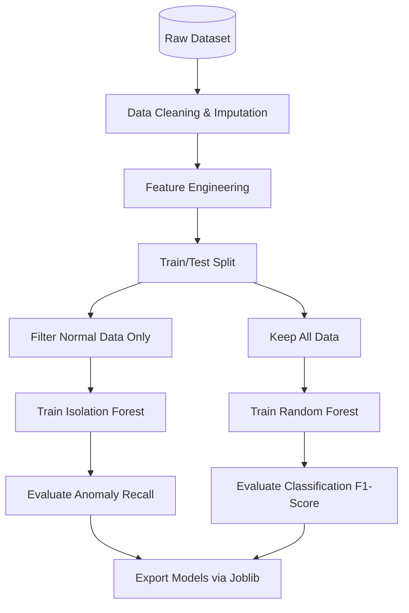

# AI Methodology

This document details the Artificial Intelligence methodology implemented in AI-MotorGuard for industrial predictive maintenance.

## 1. Problem Formulation

The system addresses two distinct machine learning problems simultaneously:
1. **Anomaly Detection (Unsupervised):** Identifying when the motor deviates from its normal baseline state without needing prior knowledge of what the specific failure is.
2. **Fault Classification (Supervised):** Categorizing the specific type of fault once an anomaly is detected, based on historical labeled patterns.

## 2. Feature Engineering Pipeline

Raw sensor data is noisy and highly volatile. We apply a sliding window feature engineering pipeline to extract meaningful statistical features.

**Extracted Features (11 total):**
- `temp_mean_5m`: 5-minute rolling average of temperature.
- `temp_rate_of_change`: Derivative of temperature over time.
- `vib_total_rms`: Root Mean Square of combined X, Y, Z vibration vectors.
- `vib_crest_factor`: Ratio of peak vibration to RMS vibration.
- `curr_variance`: Variance in current draw (detects instability).
- `curr_harmonic_distortion`: Approximated harmonic distortion factor.
- `rpm_slip`: Difference between synchronous speed and actual RPM.

## 3. Isolation Forest (Anomaly Detection)

### How it Works
Isolation Forest builds an ensemble of random decision trees (iTrees). Instead of profiling normal data, it explicitly isolates anomalies. Anomalies are few and different, making them easier to isolate (requiring fewer tree splits).

### Why Chosen
- **High-Dimensional Efficiency:** Works well with multi-sensor telemetry.
- **Unsupervised:** Does not require a comprehensively labeled dataset of all possible failures.
- **Linear Time Complexity:** Fast enough for real-time edge-gateway inference.

### Hyperparameters
- `n_estimators`: 100
- `contamination`: 0.05 (Assuming 5% of training baseline contains noise/anomalies)
- `max_samples`: 'auto'

## 4. Random Forest Classifier (Fault Classification)

### How it Works
An ensemble of decision trees trained via bagging method. Each tree predicts a class, and the final prediction is determined by majority vote.

### Why Chosen
- **Robustness:** Highly resistant to overfitting compared to single decision trees.
- **Feature Importance:** Provides interpretability (e.g., showing that vibration is the most critical feature for bearing faults).
- **Non-linear:** Captures complex, non-linear relationships between temperature, current, and vibration.

### Hyperparameters
- `n_estimators`: 200
- `max_depth`: 15
- `min_samples_split`: 5
- `class_weight`: 'balanced' (crucial for imbalanced fault datasets)

## 5. Health Score Computation Algorithm

The motor health score ($H$) is a continuous value from 0 to 100%.

```math
H = 100 - (W_a \times P_{anomaly} + W_f \times S_{severity})
```
Where:
- $P_{anomaly}$ = Normalized anomaly score from Isolation Forest (0 to 100)
- $S_{severity}$ = Severity weight of the predicted fault class (0 to 100)
- $W_a$ = Weight for anomaly confidence (0.4)
- $W_f$ = Weight for fault severity (0.6)

**Severity Matrix:**
- Normal: 0
- Misalignment: 40
- Bearing Imbalance: 60
- Overheating: 70
- Stator Short: 95

## 6. Model Training Pipeline



## 7. Evaluation Metrics

- **Isolation Forest:** Evaluated using Precision, Recall, and ROC-AUC on a validation set containing injected anomalies.
- **Random Forest:** Evaluated using Macro F1-Score and Confusion Matrix to ensure minority fault classes (rare catastrophic failures) are not ignored.

## 8. Maintenance Recommendation Logic

Based on the Health Score and Predicted Condition, the system generates automated recommendations:
- **Score > 85%:** Normal operation. Continue standard monitoring.
- **Score 60-85%:** Warning. Schedule inspection within 7 days. (e.g., Early bearing wear).
- **Score 30-60%:** Critical. Schedule maintenance at next shift change. Reduce load if possible.
- **Score < 30%:** Emergency. Immediate shutdown recommended (e.g., Stator Short circuit detected).
