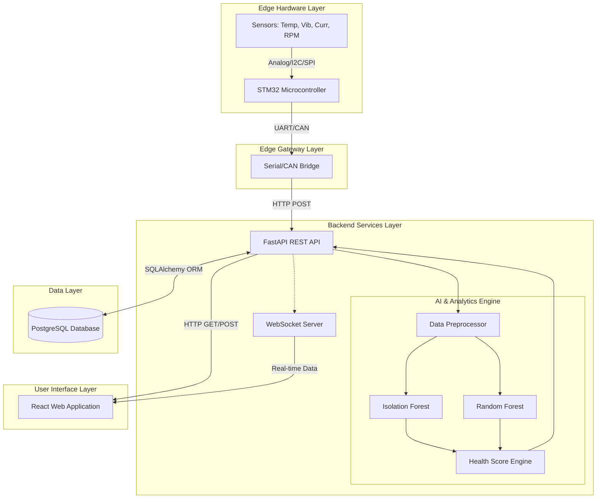
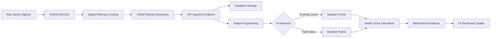
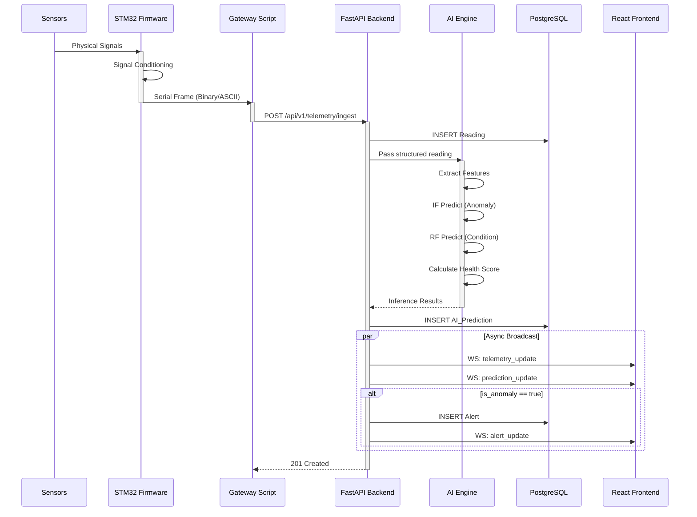

# System Architecture

This document details the architectural design of the AI-MotorGuard system.

## 1. Overall System Architecture

The system is designed as a distributed IoT application with clear boundaries between the edge sensing layer, the processing backend, and the presentation frontend.



## 2. Data Flow Architecture

The following diagram illustrates how raw sensor data is transformed into actionable maintenance insights.



## 3. Component Interaction Sequence

This sequence diagram details the real-time synchronous and asynchronous interactions from the moment a reading is taken to when it appears on the dashboard.



## 4. Deployment Architecture

The deployment is containerized using Docker, allowing for reproducible and scalable installations.

```mermaid
flowchart TD
    subgraph Host OS (Linux/Windows)
        
        subgraph Docker Compose Network
            UI_Cont["Frontend Container\n(Nginx + React)"]
            API_Cont["Backend Container\n(Uvicorn + FastAPI)"]
            DB_Cont["Database Container\n(PostgreSQL)"]
        end
        
        GatewayApp["Python Gateway Process\n(Running on Host)"]
        
        GatewayApp -->|Port 8000| API_Cont
        UI_Cont -->|Port 8000| API_Cont
        API_Cont <-->|Port 5432| DB_Cont
    end
    
    STM32["STM32 Hardware"] -->|USB/COM| GatewayApp
    User["Web Browser"] -->|Port 80| UI_Cont
```
