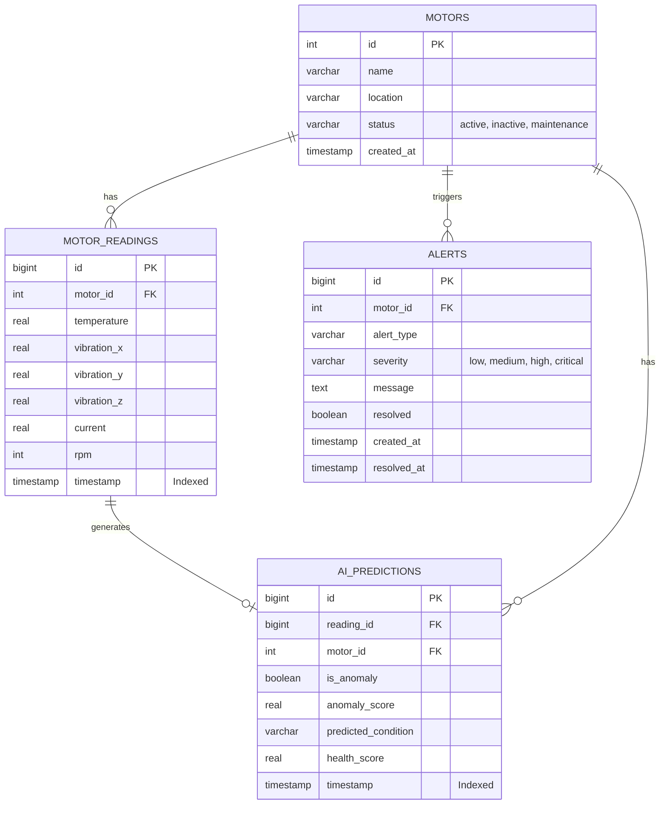

# Database Documentation

The system uses PostgreSQL for persistent storage of asset metadata, time-series telemetry, and AI predictions.

## Entity-Relationship Diagram



## Table Descriptions

### 1. `motors`
Stores configuration and metadata for physical motor assets.
- `id` (Integer, Primary Key): Unique identifier.
- `name` (String, 100): Human-readable name.
- `location` (String, 255): Physical location of the motor.
- `status` (String, 50): Current status (e.g., active).
- `created_at` (DateTime): Record creation time.

### 2. `motor_readings`
High-volume time-series table storing raw telemetry.
- `id` (BigInteger, PK): Unique ID.
- `motor_id` (Integer, FK): Reference to `motors.id`.
- `temperature` (Float): Celsius.
- `vibration_x`, `_y`, `_z` (Float): Accelerometer g-forces.
- `current` (Float): Amperes.
- `rpm` (Integer): Revolutions per minute.
- `timestamp` (DateTime): Time of reading.

### 3. `ai_predictions`
Stores the output of the ML inference pipeline for historical trending.
- `id` (BigInteger, PK): Unique ID.
- `reading_id` (BigInteger, FK): Link to specific reading.
- `motor_id` (Integer, FK): Link to motor.
- `is_anomaly` (Boolean): IF output.
- `anomaly_score` (Float): Raw anomaly probability.
- `predicted_condition` (String): RF output.
- `health_score` (Float): Computed 0-100 metric.
- `timestamp` (DateTime): Time of inference.

### 4. `alerts`
Stores actionable events generated by the system.
- `id` (BigInteger, PK): Unique ID.
- `motor_id` (Integer, FK): Affected motor.
- `alert_type` (String): Category of alert.
- `severity` (String): Urgency level.
- `message` (Text): Detailed context.
- `resolved` (Boolean): Acknowledgment status.
- `created_at` (DateTime): Alert generation time.

## Indexes
To ensure fast retrieval of time-series data for dashboard charts:
1. `idx_readings_motor_time`: B-Tree index on `motor_readings (motor_id, timestamp DESC)`.
2. `idx_predictions_motor_time`: B-Tree index on `ai_predictions (motor_id, timestamp DESC)`.
3. `idx_alerts_unresolved`: Partial index on `alerts (motor_id)` WHERE `resolved = false`.

## Migration Strategy
Database schema changes are managed using **Alembic**.
To run migrations:
```bash
alembic upgrade head
```
To create a new migration:
```bash
alembic revision --autogenerate -m "Add new column"
```
